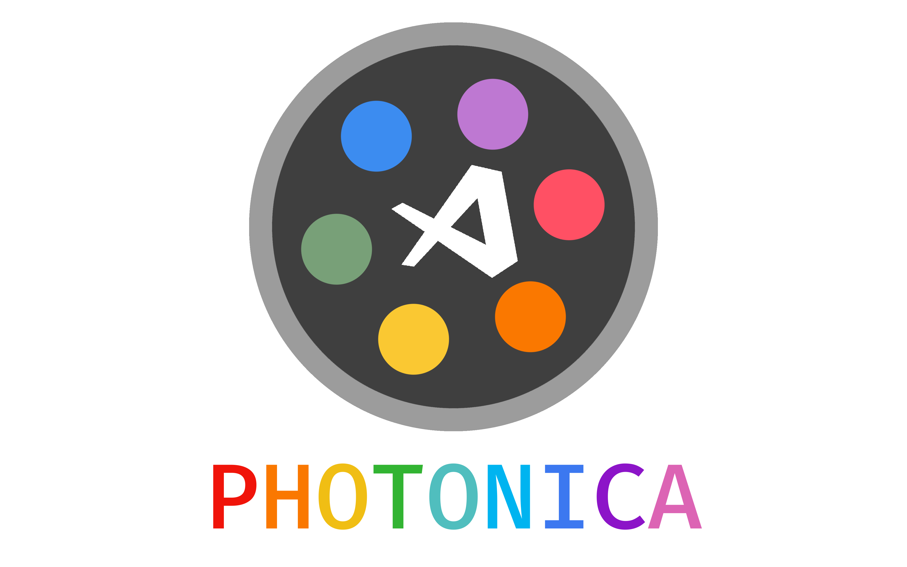
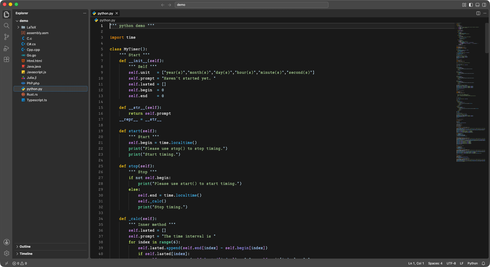
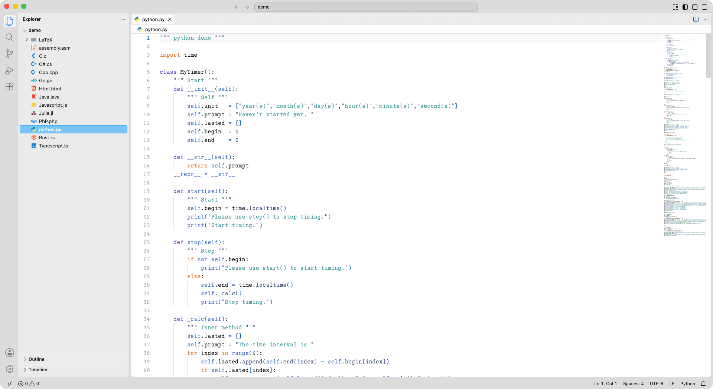
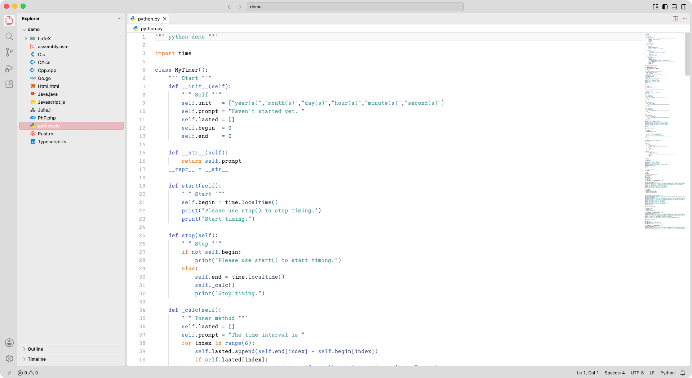
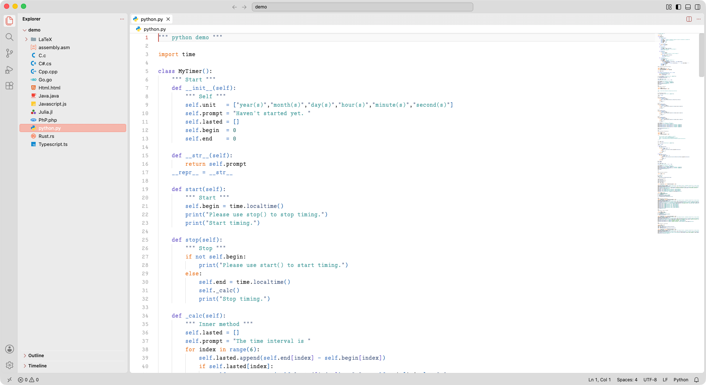
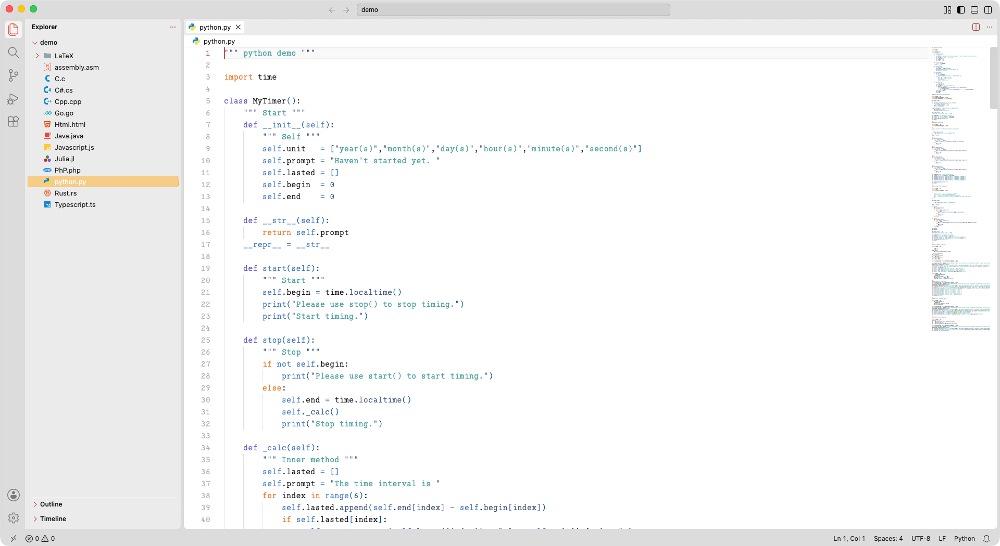
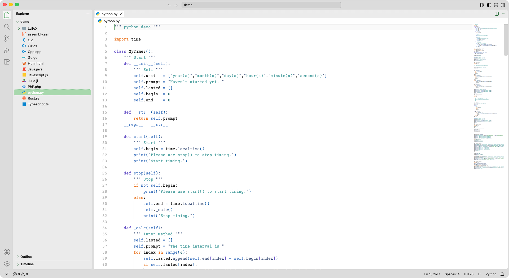
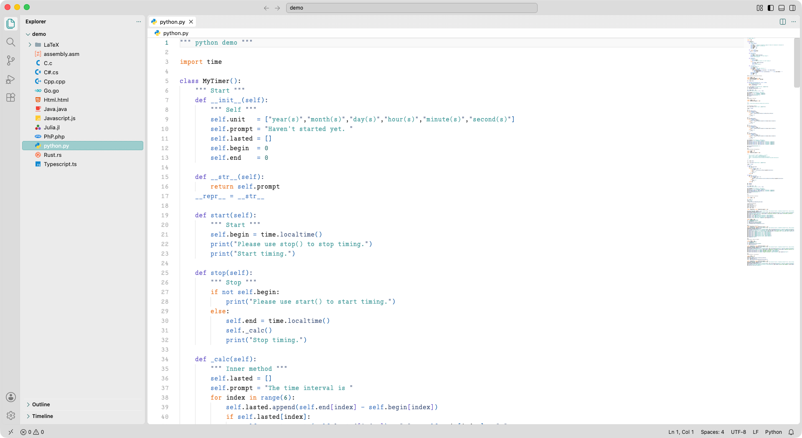
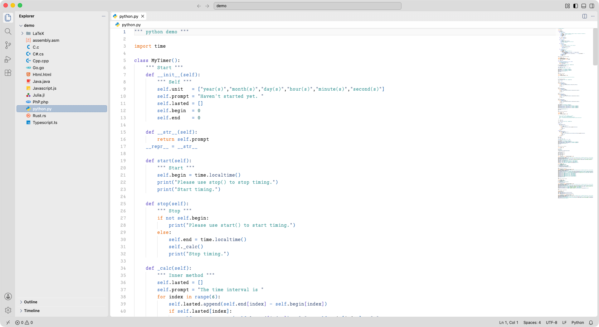
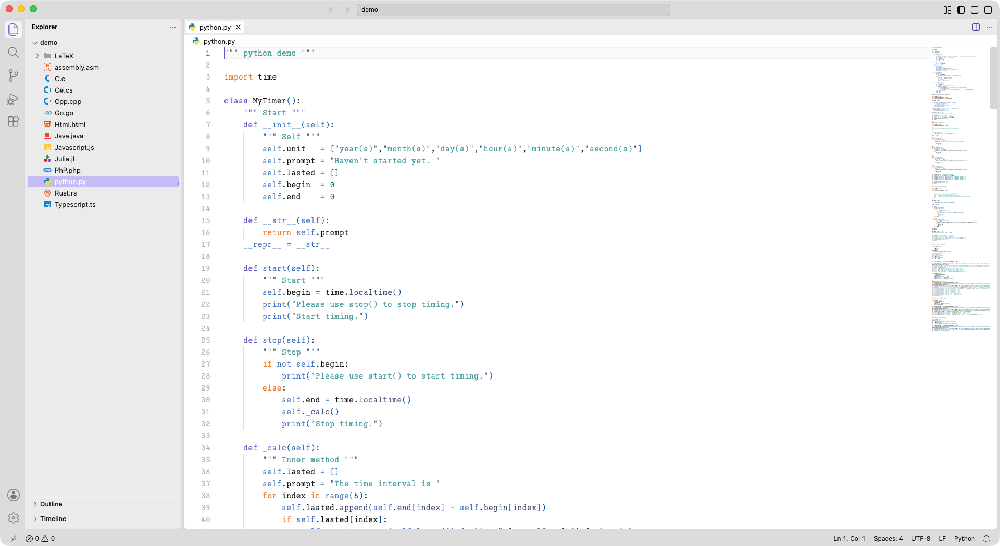

# Photonica



## About Photonica

:rainbow: [Photonica](https://marketplace.visualstudio.com/items?itemName=ConAntares.Photonica) is made for [VS Code](https://code.visualstudio.com/). It contains one dark theme and eight light themes. Its soft colors will be helpful for you to get inspired!

## Getting started

You can download and install this theme via the [Visual Studio Code Marketplace](https://marketplace.visualstudio.com/items?itemName=ConAntares.photonica).

## Installation

1. Launch Quick Open  

   * Linux:    `Ctrl` + `P`
   * macOS:    `⌘ P`
   * Windows:  `Ctrl` + `P`

    Paste the following command and press Enter:  
        ```ext Photonica```

    Or install it via sidebar panel in VS Code: Open Extension sidebar panel, and Search for "photonica";

2. Click Install to download and install it;
3. Click Reload to reload your VS Code;
4. Activate it:  
    `Manage` → `Color Theme` → `Photonica`
5. Enjoy it !

## Screenshots

Photonica Dark:



Photonica Light Azure:



Photonica Light Wine:



Photonica Light Coral:



Photonica Light Warm (formerly Light Orange; existing settings switch to it automatically):



Photonica Light Green:



Photonica Light Cyan:



Photonica Light Silver:



Photonica Light Violet:



## Preferences shown in the screenshots

* The file icons theme is [Material Icon Theme](https://marketplace.visualstudio.com/items?itemName=PKief.material-icon-theme).

* The monospace font is [Photonico Code](https://github.com/Photonico/Photonico_Code).

## More information

* Photonica is open source via [GitHub Repository](https://github.com/ConAntares/Photonica/). I will feel happy if someone can develop his themes based on Photonica.

* Welcome to use my monospace font [Photonico Code](https://github.com/Photonico/Photonico_Code).

## Acknowledgment

* The dark theme is inspired by the [Darcula Theme](https://marketplace.visualstudio.com/items?itemName=rokoroku.vscode-theme-darcula).

## License

[MIT License](https://github.com/ConAntares/Photonica/blob/master/LICENSE)

## Follow me

* E-Mail: LukeNiu@outlook.com
* GitHub: [Github.com/Photonico](https://Github.com/Photonico)

------

Enjoy it!  
✿✿ヽ(°▽°)ノ✿✿
